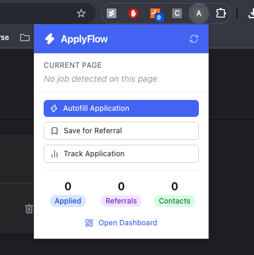

<div align="center">

# ⚡ ApplyFlow

### A Chrome extension that fills job applications for you — and gets smarter every time you use it.

ApplyFlow autofills Greenhouse, Lever, and generic ATS forms from your profile in one click. When it encounters a question it doesn't recognise — "Years of Python experience?" — it watches you answer it, asks if you'd like to remember it, and fills it automatically on every future application. It also tracks your referral queue and application pipeline, all locally, all private.

<br/>



<br/>


<sub>▶ Load in Chrome in under a minute — no server, no account, no data leaves your machine.</sub>

</div>

---

## Why

Job applications are repetitive by design. Every company uses a different ATS — Greenhouse, Lever, Workday — but they all ask the same questions. You type your name, email, LinkedIn, school, and "do you require sponsorship?" hundreds of times across a job search. Tools like Simplify Copilot exist, but they rely on a cloud profile and send your data to external servers.

ApplyFlow takes the opposite approach:

> **Everything runs locally. Your profile never leaves your browser. The extension learns from your answers — with your explicit approval — and gets better over time without phoning home.**

The autofill engine is a real matching system — not a simple `name=email` lookup. It extracts signals from every field (label text, `name` attribute, `id`, `placeholder`, `aria-label`, nearby DOM text), scores them against 60+ canonical patterns with a confidence model, picks the best match, and fills using React-compatible event dispatch so frameworks don't reject the input.

---

## What it does

<table>
  <tr>
    <td width="50%">
      <strong>⚡ Intelligent Autofill</strong><br/>
      Fills first/last name, email, phone, city, state, LinkedIn, GitHub, school, degree, GPA, work authorisation, visa sponsorship, salary, and more — across Greenhouse, Lever, and generic forms.
    </td>
    <td width="50%">
      <strong>🧠 Self-Learning Engine</strong><br/>
      Watches fields that couldn't be filled. When you answer one, a toast appears: "Remember this?" Approve it once — it auto-fills on every future application, matched by Jaccard token similarity.
    </td>
  </tr>
  <tr>
    <td width="50%">
      <strong>📋 Referral Queue</strong><br/>
      Save jobs for specific contacts in one click. The dashboard groups them by person so you can send one consolidated "hey, can you refer me to these 3 roles?" message instead of three separate asks.
    </td>
    <td width="50%">
      <strong>📊 Application Tracker</strong><br/>
      Track every application through its lifecycle — Saved → Applied → Interview → Offer. See your pipeline at a glance from the dashboard overview.
    </td>
  </tr>
</table>

---

## How the autofill engine works

```
Click "Autofill Application" in the popup
  ↓
Popup → Background service worker
Background loads profile + settings + learned answers from chrome.storage
Background → Content script (RUN_AUTOFILL with all data)
  ↓
Content script selects ATS adapter: Greenhouse? Lever? Generic?
  ↓
FieldScanner walks the DOM — inputs, selects, textareas, radio groups
Extracts signals: label, name attr, id, placeholder, aria-label, nearby text
  ↓
FieldMatcher scores each field against 60+ known patterns
(label exact match +0.45 · name/id exact +0.40 · type hint +0.35 · contains +0.20)
  ↓
Unrecognised fields checked against Learned Answers via Jaccard similarity
(similarity ≥ 0.60 → auto-fill from memory)
  ↓
ProfileResolver maps canonical field → value from your profile
FieldFiller writes each value with React-compatible event dispatch
  ↓
Result: N filled · M from memory · K unrecognised → shown in popup
  ↓
FieldObserver watches unrecognised fields for your manual input
When you fill one and blur → "🧠 Remember this answer?" toast appears
Approve → stored in learningRepository → used on every future application
```

---

## The learning engine in detail

The key insight is **Jaccard token similarity** on normalised question text:

```
"What is your experience with cloud infrastructure?"  (stored)
"Describe your cloud infrastructure experience"       (new question)

Tokens A: {what, is, your, experience, with, cloud, infrastructure}
Tokens B: {describe, your, cloud, infrastructure, experience}

Intersection: {your, experience, cloud, infrastructure} → 4
Union: 8 items → similarity = 4/8 = 0.50

≥ 0.35 threshold → suggest · ≥ 0.60 threshold → auto-fill
```

This means the same question asked differently on different ATS platforms maps to the same learned answer automatically — no manual tagging needed.

---

## Quick start

Requires Node.js 18+ and Chrome.

```bash
git clone https://github.com/IMSUMEET/applyflow.git
cd applyflow
npm install
npm run build
```

Then in Chrome:
1. Go to `chrome://extensions`
2. Enable **Developer mode** (top-right toggle)
3. Click **Load unpacked** → select the `.output/chrome-mv3/` folder
4. Pin the ⚡ ApplyFlow icon from the puzzle-piece menu

**First run:** Click the icon → Open Dashboard → My Profile → fill in your details.

---

## Development

```bash
npm run dev      # hot-reload dev mode (loads a temporary Chrome profile)
npm test         # 138 unit + integration tests
npx tsc --noEmit # type check
npm run build    # production build → .output/chrome-mv3/
```

The dev server reloads the extension live as you edit — no manual rebuild needed.

---

## Project structure

```
src/
├── entrypoints/
│   ├── background.ts          # MV3 service worker — message router
│   ├── content/               # Injected into every page
│   │   ├── index.ts           #   autofill trigger + field observer
│   │   ├── ui.ts              #   "ApplyFlow active" badge
│   │   └── learningOverlay.ts #   "Remember this answer?" toast
│   ├── popup/                 # Extension toolbar popup
│   └── dashboard/             # Full-page dashboard (React)
├── features/
│   ├── autofill/
│   │   ├── detection/         # FieldScanner, JobDetector
│   │   ├── matching/          # FieldMatcher, KnownMappings, Normalizer
│   │   ├── filling/           # FieldFiller, ProfileResolver, EventDispatcher
│   │   └── adapters/          # Greenhouse, Lever, Generic + registry
│   └── learning/
│       ├── similarityMatcher.ts  # Jaccard similarity engine
│       └── fieldObserver.ts      # DOM listener for unrecognised fields
├── storage/                   # Repository pattern over chrome.storage.local
├── messaging/                 # Typed discriminated-union message system
└── models/                    # Zod schemas: Profile, Job, Referral, Learning
```

---

## Privacy

- **No account required.** No sign-up, no login, no cloud profile.
- **No data leaves your machine.** Profile, learned answers, and application history are stored exclusively in `chrome.storage.local`.
- **No silent learning.** The extension never saves an answer without an explicit "Remember" approval.
- **No auto-submit.** ApplyFlow fills fields — it never clicks Submit.
- **Principle of least privilege.** Only requests permissions it actually uses: `storage`, `activeTab`, `tabs`.

---

## Stack

| Layer | Technology |
|---|---|
| Extension framework | WXT 0.21 (Vite-based, MV3) |
| UI | React 19, Tailwind CSS v3, Lucide React |
| Language | TypeScript (strict, verbatimModuleSyntax) |
| Validation | Zod v4 |
| Tests | Vitest + jsdom (138 tests) |
| Storage | chrome.storage.local via typed repositories |

---

<div align="center">
<sub>Built with the goal of making a job search a little less painful.</sub>
</div>
